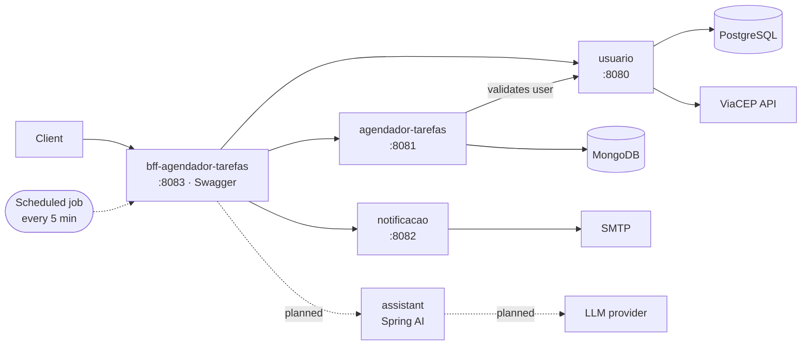

# Task Scheduler Platform

A task scheduling system built as **Spring Boot microservices**. Users sign up, create tasks with a date and time, and get an e-mail reminder before each task is due.

This repository is the **entry point** for the whole system: architecture, how the services talk to each other, a single `docker compose` file to run everything, and the roadmap. The code of each service lives in its own repository.

> **Status: work in progress.** The four services below exist and run individually. Running the full stack with one command, Java 21, test coverage and the AI assistant are being built in the open — see the [roadmap](#roadmap).

## Architecture



**Request flow:** the client only talks to the BFF. The BFF forwards calls to the services with OpenFeign. Every 5 minutes a scheduled job in the BFF fetches the tasks due in the next hour, asks `notificacao` to send the reminder e-mail and marks the task as notified.

## Services

| Service | Responsibility | Stack |
| --- | --- | --- |
| [usuario](https://github.com/GabrielBarrilli/usuario) | Sign-up, JWT login, addresses and phones, ZIP code lookup (ViaCEP) | Spring Boot, Spring Security + JWT, Spring Data JPA, PostgreSQL |
| [agendador-tarefas](https://github.com/GabrielBarrilli/agendador-tarefas) | Task CRUD, search by period, notification status | Spring Boot, Spring Data MongoDB, OpenFeign |
| [notificacao](https://github.com/GabrielBarrilli/notificacao) | Sends HTML e-mails from templates | Spring Boot, Spring Mail, Thymeleaf |
| [bff-agendador-tarefas](https://github.com/GabrielBarrilli/bff-agendador-tarefas) | Backend for Frontend: single entry point, OpenAPI docs, reminder job | Spring Boot, OpenFeign, Springdoc OpenAPI |
| assistant *(planned)* | Turns natural language ("remind me tomorrow at 3pm to call the client") into a task | Spring AI |

## Running locally

Requirements: Docker with Compose v2.

```bash
git clone https://github.com/GabrielBarrilli/task-scheduler-platform.git
cd task-scheduler-platform
cp .env.example .env   # fill in the values
docker compose up --build
```

Compose builds each service straight from its GitHub repository, so you don't need to clone them one by one.

| What | URL |
| --- | --- |
| API docs (Swagger UI) | http://localhost:8083/swagger-ui/index.html |
| BFF | http://localhost:8083 |

> The one-command setup is tracked in the roadmap and is not yet verified end to end.

## Roadmap

Tracked as [issues](https://github.com/GabrielBarrilli/task-scheduler-platform/issues):

- [ ] Run the whole stack with `docker compose up` from a clean clone
- [ ] Upgrade every service to Java 21 and align Spring Boot versions
- [ ] Unit and integration tests with JaCoCo coverage badges
- [ ] CI on every push, with build badges
- [ ] AI assistant service with Spring AI
- [ ] Service READMEs in English

## Author

**Gabriel Barrilli** — Java backend developer · [LinkedIn](https://www.linkedin.com/in/gabriel-barrilli) · [GitHub](https://github.com/GabrielBarrilli)
